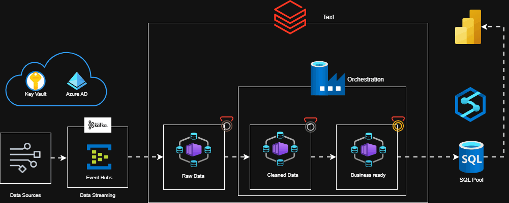
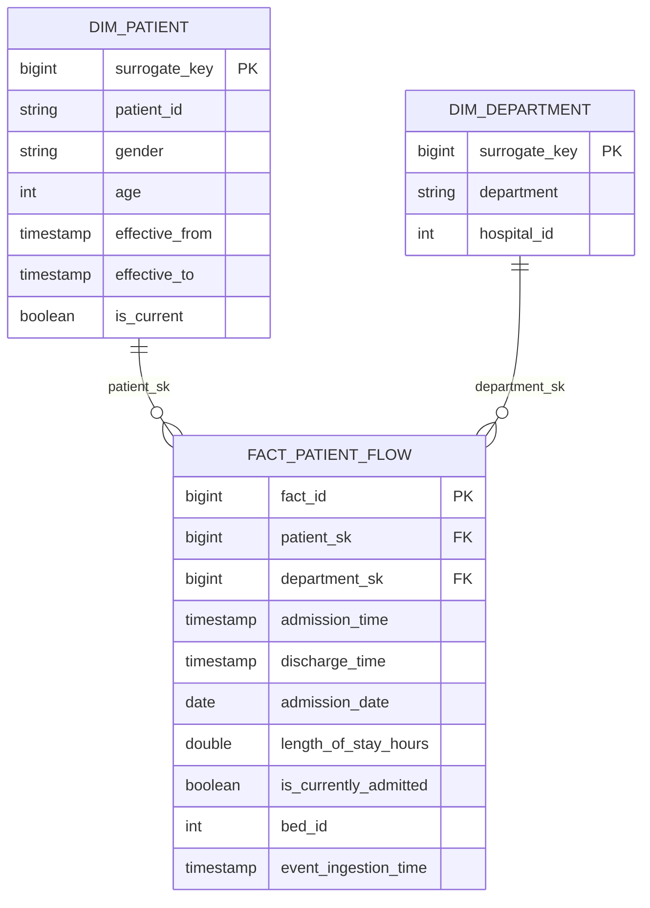

# 🏥 Hospital Patient Flow Analytics on Azure

**Real-time patient flow monitoring for a multi-hospital network, built on Azure Event Hubs, Databricks, Delta Lake, Data Factory, Synapse and Power BI.**


<p align="center">
  🏨 <b>Patients</b> ➜ 📡 <b>Event Hubs</b> ➜ 🥉 <b>Bronze</b> ➜ 🥈 <b>Silver</b> ➜ 🥇 <b>Gold</b> ➜ 🏢 <b>Synapse</b> ➜ 📊 <b>Power BI</b>
</p>

---

## 📑 Table of contents
1. 🏥 [Business request](#-1-business-request)
2. 🧱 [Solution architecture](#-2-solution-architecture)
3. 🧰 [Tech stack](#-3-tech-stack)
4. 📁 [Repository structure](#-4-repository-structure)
5. 📡 [Data source: patient flow simulator](#-5-data-source-patient-flow-simulator)
6. 🔷 [Azure resources](#-6-azure-resources)
7. 🥉 [Bronze layer: raw ingestion](#-7-bronze-layer-raw-ingestion)
8. 🥈 [Silver layer: cleaning and data quality](#-8-silver-layer-cleaning-and-data-quality)
9. 🥇 [Gold layer: star schema and SCD Type 2](#-9-gold-layer-star-schema-and-scd-type-2)
10. 🔄 [Orchestration with Azure Data Factory](#-10-orchestration-with-azure-data-factory)
11. 📊 [Analytics: Synapse and Power BI](#-11-analytics-synapse-and-power-bi)
12. 🔐 [Security](#-12-security)
13. 🌿 [Version control](#-13-version-control)
14. 🚀 [How to run](#-14-how-to-run)
15. 🎯 [Skills demonstrated](#-15-skills-demonstrated)
16. 🔮 [Future enhancements](#-16-future-enhancements)

---

## 🏥 1. Business request

### 📌 Background
**Midwest Health Alliance (MHA)**, a fictional client used for this project, runs a network of **7 hospitals** across the US Midwest. It struggles to manage patient flow, especially in high-demand periods such as seasonal flu outbreaks.

MHA has **no central, real-time view** of bed occupancy, admission and discharge patterns, or how busy each department is.

### 🎯 Business objectives
- Monitor patient admissions in real time to **reduce waiting times**
- Identify **department bottlenecks** (e.g. Emergency, Surgery, ICU)
- Provide **gender- and age-based KPIs** for demographic insight
- **Automate alerts** when pipelines fail

### 📋 Functional requirements

| Area | Requirement |
|---|---|
| **Data sources** | Real-time admission/discharge events from hospital registration systems · daily batch extracts from Electronic Health Records (EHR) · department metadata (capacity, staff numbers) |
| **Processing & storage** | Medallion architecture (Bronze, Silver, Gold) · schema evolution when new patient attributes appear · **SCD Type 2** for patient and department history · **star schema** for reporting tables |
| **Analytics** | Azure Synapse for analytical queries · Power BI dashboards: current occupancy % by department, occupancy by gender, average length of stay |
| **Orchestration** | Azure Data Factory to automate daily EHR batch ingestion, real-time processing triggers and Gold-layer refreshes |
| **Data quality** | Simulate realistic dirty data (missing admission times, duplicate patient IDs, wrong timestamps) and handle it in the Silver layer |
| **Security** | Role-based access control by hospital department |

### ✅ Success criteria
- Dashboards refresh frequently enough for a near real-time view
- All pipelines are fully automated through Azure Data Factory
- Schema changes do not cause downtime

### 📦 Deliverables
- A working Azure data pipeline
- A Power BI dashboard connected to live Synapse queries
- Data quality and validation reports
- Full documentation: architecture, data models and Git repository

---

## 🧱 2. Solution architecture




---

## 🧰 3. Tech stack

| Layer | Technology |
|---|---|
| Data generation | Python, Apache Kafka client, Anaconda |
| Streaming ingestion | Azure Event Hubs (Kafka protocol) |
| Processing | Azure Databricks, PySpark, Spark Structured Streaming |
| Storage | Azure Data Lake Storage Gen2, Delta Lake |
| Data modelling | Medallion architecture, star schema, SCD Type 2 |
| Orchestration | Azure Data Factory |
| Serving & analytics | Azure Synapse Analytics |
| Visualisation | Power BI |
| Security | Azure Key Vault, Databricks secret scopes, role-based access control |
| Version control | Git, Git Bash, GitHub |

---

## 📁 4. Repository structure

```
hospital-patient-flow-analytics/
├── simulator/
│   └── patient_flow_generator.py    # Streams synthetic patient events to Event Hubs
├── databricks-notebooks/
│   ├── 01_bronze_rawdata.py          # Event Hubs → Bronze (raw JSON)
│   ├── 02_silver_cleandata.py        # Bronze → Silver (clean, validated)
│   └── 03_gold_transform.py          # Silver → Gold (dimensions and fact)
├── sqlpool-queries/                  # Synapse DDL and analytical queries
└── README.md
```

---

## 📡 5. Data source: patient flow simulator

A Python producer simulates live data from hospital registration systems. It generates **one patient record per second** with these fields:

| Field | Description |
|---|---|
| `patient_id` | Unique patient identifier |
| `gender` | Patient gender |
| `age` | Patient age in years |
| `department` | Admitting department (e.g. Emergency, Surgery, ICU) |
| `admission_time` | Date and time of admission |
| `discharge_time` | Date and time of discharge |
| `bed_id` | Assigned bed |
| `hospital_id` | Hospital within the network (1–7) |

**Deliberate dirty data** tests the cleaning logic in the Silver and Gold layers:

| Issue | Rate | Handled in |
|---|---|---|
| Invalid age (110–150) | ~5% of records | Silver: set to NULL and flagged with `is_age_invalid` |
| Future `admission_time` | ~5% of records | Silver: reset to processing time |
| Duplicate events (same `patient_id` re-sent) | ~3% of events | Gold: deduplicated with `row_number()` |

**Local prerequisites:** Python, Apache Kafka and Anaconda. The simulator reads its Event Hubs connection details from a configuration file and runs from the Anaconda Command Prompt.

---

## 🔷 6. Azure resources

| Resource | Purpose | Configuration |
|---|---|---|
| **Azure Event Hubs** | Receives the real-time event stream | Messages retained for **1 hour** |
| **Azure Databricks** | Runs the Bronze, Silver and Gold notebooks | Minimum-size compute to keep costs low |
| **Storage account (ADLS Gen2)** | Medallion data lake | Folders: `bronze`, `silver`, `gold`, `synapse-workspace` |
| **Azure Key Vault** | Stores connection strings and access keys as secrets | Role-based access for each service |
| **Azure Data Factory** | Pipeline orchestration and failure alerts | See [section 10](#-10-orchestration-with-azure-data-factory) |
| **Azure Synapse Analytics** | SQL warehouse for reporting | See [section 11](#-11-analytics-synapse-and-power-bi) |

---

## 🥉 7. Bronze layer: raw ingestion
**Notebook:** `01_bronze_rawdata.py`

- Connects Databricks to Event Hubs through its **Kafka-compatible endpoint** (SASL_SSL)
- Reads the stream continuously with **Spark Structured Streaming**
- Converts Kafka's **binary message value to a JSON string**
- Writes raw events, **append-only**, to a **Delta table** in the `bronze` folder
- Uses **checkpointing** so the stream can restart without losing or duplicating data

Bronze keeps the data exactly as it arrived, so it can always be reprocessed.

---

## 🥈 8. Silver layer: cleaning and data quality
**Notebook:** `02_silver_cleandata.py`

| Step | What it does |
|---|---|
| **Schema enforcement** | Parses the raw JSON against an explicit `StructType` schema |
| **Type conversion** | Converts `admission_time` and `discharge_time` to timestamps |
| **Invalid dates** | Fixes missing or future admission times |
| **Invalid ages** | Corrects ages above 100 |
| **Schema evolution** | Ensures every expected column exists, and writes with `mergeSchema` so new attributes are added **without breaking the pipeline** |
| **Streaming write** | Writes continuously to the Silver Delta table, with its own checkpoint |

This meets the success criterion that **schema changes do not cause downtime**.

---

## 🥇 9. Gold layer: star schema and SCD Type 2
**Notebook:** `03_gold_transform.py`

### 🗂 Data model



### 🧠 Key logic
- **Deduplication:** keeps the latest admission per patient using a `row_number()` window, which handles duplicate patient IDs
- **SCD Type 2 patient dimension:**
  - Detects changes with a **SHA-256 hash** of the tracked attributes
  - Closes the old version (`is_current = false`, `effective_to` set) and inserts a new current version
  - Keeps full patient history for accurate reporting over time
- **Department dimension:** one row per department and hospital
- **Fact table:** joins events to surrogate keys and adds business metrics:
  - `length_of_stay_hours`
  - `is_currently_admitted`
- **Sanity checks:** prints row counts for each Gold table after every run

---

## 🔄 10. Orchestration with Azure Data Factory

Azure Data Factory automates the pipeline end to end:

- **Daily batch ingestion** of EHR extracts
- **Triggers** for the Databricks processing notebooks
- **Gold-layer refresh**, so dashboards always show current data
- **Failure alerts**, so the team is notified when a pipeline run fails

<!-- Add a screenshot of the ADF pipeline here:  -->

---

## 📊 11. Analytics: Synapse and Power BI

### 🏢 Azure Synapse
- Gold Delta tables are exposed to **Azure Synapse** as the reporting warehouse
- DDL scripts in `sqlpool-queries/` create the warehouse objects over the Gold layer
- Analytical queries answer the business questions directly in SQL

### 📈 Power BI dashboard
Power BI connects to Synapse and reports these KPIs:

| KPI | Business question |
|---|---|
| **Current occupancy % by department** | Which departments are under pressure right now? |
| **Gender-based occupancy distribution** | How is bed use split by gender? |
| **Average length of stay** | How long do patients stay, by department and hospital? |
| **Admissions over time** | When are the peaks, for example during flu season? |

<!-- Add the dashboard screenshot here:  -->

---

## 🔐 12. Security

- **No secrets in code:** all connection strings and access keys are stored in **Azure Key Vault**
- Databricks reads secrets through a **Key Vault-backed secret scope**
- Access to each resource is granted by **role**, following least privilege
- The project design includes **role-based access by hospital department**

---

## 🌿 13. Version control

The project is version-controlled with **Git** and published to **GitHub**:

1. Create a local folder, `hospital-patient-flows`
2. Initialise Git with `git init` and add a README
3. Create the folder structure for the simulator, Databricks notebooks and SQL scripts
4. Commit changes and push to GitHub using **Git Bash**

Databricks notebooks are also backed up to the GitHub repository from inside Databricks.

---

## 🚀 14. How to run

1. **Create the Azure resources** in [section 6](#-6-azure-resources)
2. **Add secrets to Key Vault:** the Event Hubs connection string and the storage account key
3. **Create a Databricks secret scope** linked to Key Vault
4. **Set up the simulator:** fill in the configuration file with the Event Hubs details
5. **Start the stream:** run `patient_flow_generator.py` from the Anaconda Command Prompt
6. **Run the notebooks** in order: `01_bronze_rawdata` → `02_silver_cleandata` → `03_gold_transform`
7. **Deploy the ADF pipeline** to automate and schedule the steps
8. **Run the Synapse DDL** in `sqlpool-queries/`
9. **Open the Power BI report** and connect it to Synapse

---

## 🎯 15. Skills demonstrated

- Translating a business requirements document into a technical solution
- Real-time streaming with **Event Hubs, Kafka and Spark Structured Streaming**
- Medallion lakehouse design on **Delta Lake and ADLS Gen2**
- Data quality rules, schema enforcement and **zero-downtime schema evolution**
- Dimensional modelling with a **star schema** and **SCD Type 2**
- Pipeline orchestration and alerting with **Azure Data Factory**
- Cloud data warehousing with **Azure Synapse**
- KPI dashboards in **Power BI**
- Secure secret management with **Azure Key Vault**
- Version control with **Git and GitHub**

---

## 🔮 16. Future enhancements

- Add **department metadata** (capacity, staff numbers) as a source, enriching the department dimension so occupancy % is calculated against real bed capacity
- Extend **SCD Type 2** to the department dimension
- Use stable surrogate keys (identity columns or hash keys) instead of `monotonically_increasing_id()`
- Partition the fact table by `admission_date` for faster queries
- Send invalid records to a **quarantine table** instead of correcting them in place
- Add automated **data quality reports** with Great Expectations or Databricks Lakehouse Monitoring
- Add **CI/CD** for notebooks and ADF pipelines with Azure DevOps or GitHub Actions

---

## 👤 Author

**Opeyemi Abolade**, Data Engineer & Power BI Developer (Azure · Microsoft Fabric · Databricks)

*This is a portfolio project. Midwest Health Alliance is a fictional client, and all patient data is synthetic.*
